<div align="center">

  

  # 🔍 Awesome IT Discovery

  <p align="center">
    <strong>A curated directory of enterprise IT Discovery Platforms, Agentless Network Scanners, Automated CMDB Population Engines, and Hybrid Cloud Asset Mapping Architectures.</strong>
  </p>

  <p align="center">
    <a href="https://github.com/ishandutta2007/Awesome-Awesome-Awesome"></a><a href="https://discord.gg/jc4xtF58Ve"></a>
    <a href="https://github.com/ishandutta2007/Awesome-IT-Discovery/stargazers"></a>
    <a href="https://github.com/ishandutta2007/Awesome-IT-Discovery/network/members"></a>
    <a href="https://github.com/ishandutta2007/Awesome-IT-Discovery/blob/main/LICENSE"></a>
    <a href="https://github.com/ishandutta2007/Awesome-IT-Discovery/pulls"></a>
    <a href="https://github.com/ishandutta2007"></a>
  </p>

</div>

---

## 📖 Overview & Architecture Landscape

In modern hybrid infrastructure, an **IT Discovery Engine** serves as the foundational reconnaissance layer for IT Operations Management (ITOM), Cyber Asset Attack Surface Management (CAASM), and IT Asset Management (ITAM). It continuously scans, identifies, fingerprints, and classifies every physical, virtual, and cloud asset across an enterprise—transforming ephemeral endpoints and blind spots into an audit-ready, real-time Configuration Management Database (CMDB).

A resilient enterprise IT Discovery architecture integrates five core discovery vectors:
1. **Agentless Network Scanning**: Probing subnets and switches using standard protocols including SNMP (v1/v2c/v3), WMI, WinRM, SSH, NetBIOS, ARP, and LLDP/CDP to map Layer 2 and Layer 3 topologies without requiring client software.
2. **Cloud & Hypervisor Telemetry**: Ingesting real-time inventory from AWS, Microsoft Azure, Google Cloud Platform (GCP), VMware vCenter, Nutanix, and Kubernetes APIs to track transient serverless compute and ephemeral microservices.
3. **Passive Network Traffic Analysis**: Sniffing mirrored switch traffic (SPAN/TAP ports) and DHCP/DNS transaction logs to detect unmanaged hardware and rogue shadow IT devices instantaneously upon connecting to the LAN.
4. **Agent-Based Host Introspection**: Lightweight daemons deployed on corporate laptops and air-gapped workstations capturing granular package manifests, running processes, daemon sockets, and software license usage.
5. **Application Dependency Mapping (ADM)**: Correlating TCP/UDP connection tables, SSL/TLS certificates, and service ports to construct dynamic relational graphs of business services and upstream/downstream blast radii.

---

## 📑 Table of Contents

- [🌐 Sector Overview & Market Dynamics](#-sector-overview--market-dynamics)
- [☁️ SaaS & Commercial IT Discovery Platforms](#️-saas--commercial-it-discovery-platforms)
- [🔓 Open-Source IT Discovery Projects (Ranked by Stars)](#-open-source-it-discovery-projects-ranked-by-stars)
- [📊 Architectural Comparison Matrix](#-architectural-comparison-matrix)
- [🤝 How to Contribute](#-how-to-contribute)
- [📈 Star History](#-star-history)
- [💖 Support & Sponsorship](#-support--sponsorship)
- [⚖️ Disclaimer](#-disclaimer)

---

## 🌐 Sector Overview & Market Dynamics

The global **IT Asset Discovery and Management market** was valued at approximately **$2.9 Billion in 2024** and is projected to expand to **$7.4 Billion by 2030**, reflecting a Compound Annual Growth Rate (**CAGR of ~16.8%**) within the broader **$45+ Billion IT Operations Management (ITOM)** sector. This momentum is propelled by rapid hybrid-cloud sprawl, stringent regulatory compliance mandates (NIS2, DORA, SOC 2, ISO 27001), and the urgent requirement for real-time cyber asset attack surface visibility to counter unmanaged shadow IT.

The sector demonstrates a **moderately fragmented market structure**: hyperscalers and enterprise titans (Microsoft Defender for Endpoint, ServiceNow Discovery) exert powerful gravitational pull over large enterprises requiring tightly coupled CMDB and EDR ecosystems. Concurrently, a vibrant ecosystem of specialized mid-market network appliances (Lansweeper, Device42, ManageEngine, SolarWinds) and self-hosted open-source scanners (NetBox, Nmap, GLPI) flourish across mid-size organizations and sovereign environments demanding strict data residency, air-gapped deployment, and zero per-asset subscription overhead.

---

## ☁️ SaaS & Commercial IT Discovery Platforms

The table below catalogs leading commercial and SaaS IT discovery platforms, sorted in descending order by parent company scale (market capitalization or valuation).

| Platform & Vendor | Company Size / Valuation | Starting Pricing | Free Tier / Free Trial Limits | Core Discovery Methods & Engine | Primary Best-Fit Workload |
| :--- | :--- | :--- | :--- | :--- | :--- |
| **[Microsoft Defender for Endpoint](https://www.microsoft.com/en-us/security/business/microsoft-defender-endpoint)** | **$3.12T Market Cap**<br>*(FY24 Rev: $245B)* | **$3.00/user/month**<br>*(Plan 1, annual commit; Plan 2 at $5.20/user/month)* | **30-Day Free Trial**<br>*(Up to 25 licenses with complete EDR, network device discovery & vulnerability mapping)* | Passive endpoint telemetry, active network probing via onboard agents, Azure Arc integration | Organizations invested in Microsoft 365 / Azure enterprise security estates |
| **[ServiceNow Discovery](https://www.servicenow.com/products/it-operations-management/discovery.html)** | **$195B Market Cap**<br>*(2024 Rev: ~$10.0B)* | **~$80 – $120/node/year**<br>*(ITOM Visibility units; typical starting entry ~$8,000 – $15,000/year contract)* | **Free Personal Developer Instance**<br>*(Permanent PDI on developer.servicenow.com with active login; 30-day enterprise PoC by request)* | Agentless MID Server (SNMP, WMI, SSH), ML fingerprinting, Application Dependency Mapping (ADM) | Fortune 500 enterprises standardizing on ServiceNow CMDB & ITIL service graphs |
| **[ManageEngine AssetExplorer](https://www.manageengine.com/products/asset-explorer/)** | **~$10B Valuation**<br>*(Zoho Corp Rev: $1.4B)* | **$955/year**<br>*(250 IT assets, Standard/Professional tier; scales to $11,995/yr for 10k assets)* | **Free Plan Forever (25 Assets)**<br>*(Free forever for 25 nodes on-prem or 50 nodes cloud; 30-day free trial up to 250 assets)* | Agentless IP-range scan, SNMP, WMI, Active Directory sync, and lightweight workstation agent | Mid-market IT teams seeking an all-inclusive ITAM, software license audit & CMDB suite |
| **[Qualys Cloud Platform (CSAM)](https://www.qualys.com/apps/cybersecurity-asset-management/)** | **$5.8B Market Cap**<br>*(2024 Rev: ~$560M)* | **~$1,995/year**<br>*(Starting bundle for 32 IPs; volume tiers at ~$15 – $35/asset/year)* | **Free Community Edition Forever**<br>*(Free forever for 16 internal assets, 3 external assets & 1 web app; 30-day full CSAM trial)* | Passive network sensors, Cloud Agent, external attack surface scanner, API cloud connectors | Security operations & IT compliance teams requiring automated risk-scoring (TruRisk) |
| **[BMC Helix Discovery](https://www.bmc.com/it-solutions/bmc-helix-discovery.html)** | **~$5.0B Valuation**<br>*(Annual Rev: ~$2.1B)* | **$50,000/year starter bundle**<br>*(Framework rates at £15.75 (~$20)/node/month; ~$80–$140/endpoint/month list)* | **30-Day Guided Proof of Concept**<br>*(Enterprise PoC sandbox deployment with sample discovery appliances & outposts)* | Lightweight Outpost appliances (agentless SSH, SNMP, WMI), multi-cloud discovery, automated ADM | Complex hybrid enterprises operating mission-critical BMC Helix ITSM/Atrium CMDB |
| **[Device42](https://www.device42.com/)** | **$4.5B Parent MCap**<br>*(Freshworks buyout: $230M)* | **$1,449/year**<br>*(Core Tier: 1–100 devices and up to 1,000 IP addresses)* | **14-Day Free Trial**<br>*(Full functionality for up to 1,000 autodiscovered devices and complete CMDB mapping)* | Agentless autodiscovery (SNMP, WMI, SSH), physical rack & patch cable DCIM, cloud API sync | Hybrid data centers, colocation facilities, and teams needing combined IPAM & DCIM |
| **[SolarWinds Network Discovery](https://www.solarwinds.com/network-performance-monitor)** | **$2.1B Market Cap**<br>*(2024 Rev: ~$785M)* | **$8/node/month**<br>*(Observability self-hosted; perpetual licenses start at $1,813 for SL100 tier)* | **30-Day Free Trial**<br>*(Fully functional without element limits, including Network Sonar Wizard discovery)* | Network Sonar Wizard (SNMP v1/v2c/v3, ICMP, WMI, CDP, LLDP), Layer 2/3 topology auto-mapping | Network engineers and sysadmins managing extensive on-premises routing & switching fleets |
| **[Lansweeper](https://www.lansweeper.com/)** | **~$350M Valuation**<br>*(Insight Partners / $60M+ ARR)* | **€2,199/year (~$2,390/yr)**<br>*(Starter plan, billed annually at ~$199/month for up to 2,000 managed assets)* | **Free Plan Forever (100 Assets)**<br>*(Free forever for up to 100 assets with full scan details & unlimited seats; 14-day Pro trial)* | Agentless deep scan (WMI, SSH, SNMP), active scanning engine, Lansweeper IT Agent, cloud asset sync | IT departments seeking fast agentless discovery without deploying complex gateway servers |
| **[UVexplorer](https://www.uvexplorer.com/)** | **~$120M Valuation**<br>*(Paessler AG / PRTG)* | **$1,975/year**<br>*(UVexplorer Pro managed interface/port licensing; Server edition at $2,995/yr)* | **Free UVX-500 Edition (1 Year)**<br>*(Free 1-year renewable license for up to 500 network interfaces; 15-day Server trial)* | Layer 2/Layer 3 automated discovery, router port mapping, SNMP MIB walk, PRTG CMDB sync | MSPs and network administrators requiring automated Visio-compatible network diagrams |
| **[Virima](https://virima.com/)** | **~$25M Valuation**<br>*(Private / Rev: ~$12M)* | **$395/month ($4,740/year)**<br>*(Business Pro tier billed annually for up to 2,000 assets / CI records)* | **30-Day Guided Proof of Value**<br>*(Full deployment in customer environment supporting up to 500 managed assets)* | Discovery Agent & agentless probes, dynamic service mapping, automated hardware lifecycle audit | Mid-market enterprises seeking out-of-the-box discovery integrations with ServiceNow/Jira |

---

## 🔓 Open-Source IT Discovery Projects (Ranked by Stars)

The following open-source projects provide community-driven, sovereign alternatives for asset discovery, network crawling, IPAM, and CMDB inventory. They are ranked in descending order by GitHub stargazers.

- ### **[NetBox](https://github.com/netbox-community/netbox)** [](https://github.com/netbox-community/netbox/stargazers)
  The premier open-source Infrastructure Source of Truth (SOT) designed specifically for network automation, IP address management (IPAM), and Data Center Infrastructure Management (DCIM). NetBox models physical cabling, device racks, virtual machines, VLANs, and IP prefixes, functioning as the central target CMDB for automated network discovery ingest pipelines and Ansible/Terraform orchestration.

- ### **[Snipe-IT](https://github.com/snipe/snipe-it)** [](https://github.com/snipe/snipe-it/stargazers)
  A powerful open-source IT asset management system written in PHP/Laravel. Snipe-IT tracks hardware lifecycles, software licenses, depreciation, and user assignments, featuring an extensive REST API that seamlessly ingests discovery feeds from agentless network scanners, Active Directory sync utilities, and Jamf/Intune MDM systems.

- ### **[Nmap](https://github.com/nmap/nmap)** [](https://github.com/nmap/nmap/stargazers)
  The legendary network exploration tool and security scanner that serves as the core discovery engine for modern infrastructure mapping. Nmap performs high-speed host discovery, port scanning, OS fingerprinting, and application version detection via raw IP packets and the Nmap Scripting Engine (NSE), producing structured XML outputs suitable for populating enterprise asset inventories.

- ### **[ScoutSuite](https://github.com/nccgroup/ScoutSuite)** [](https://github.com/nccgroup/ScoutSuite/stargazers)
  An open-source multi-cloud security auditing and asset inventory discovery tool. ScoutSuite queries cloud provider APIs (AWS, Microsoft Azure, Google Cloud, Alibaba Cloud, and Oracle Cloud) to automatically discover deployed storage buckets, compute instances, identity roles, and network security groups, compiling findings into an interactive HTML attack-surface report.

- ### **[CloudQuery](https://github.com/cloudquery/cloudquery)** [](https://github.com/cloudquery/cloudquery/stargazers)
  An open-source high-performance ELT (Extract, Load, Transform) data integration framework designed for cloud infrastructure asset discovery. CloudQuery discovers and extracts asset state across cloud providers, Kubernetes clusters, SaaS applications, and on-premises hypervisors, syncing real-time inventory records into standard SQL databases (PostgreSQL, BigQuery, Snowflake) for ad-hoc SQL querying.

- ### **[GLPI](https://github.com/glpi-project/glpi)** [](https://github.com/glpi-project/glpi/stargazers)
  An enterprise-grade open-source IT Asset Management (ITAM), Service Desk, and CMDB platform. When paired with the native **GLPI-Agent**, it delivers automated agentless network discovery (SNMP v1/v2c/v3 query sweeps) and deep endpoint inventory across Windows, Linux, macOS, and Android systems without requiring per-node subscription licensing.

- ### **[LibreNMS](https://github.com/librenms/librenms)** [](https://github.com/librenms/librenms/stargazers)
  An auto-discovering network monitoring and discovery system based on PHP and MySQL. LibreNMS discovers entire network infrastructures using SNMP, CDP, LLDP, FDP, OSPF, and BGP routing protocols, automatically mapping Layer 2/Layer 3 device connectivity, switch port relationships, and interface bandwidth statistics.

- ### **[OpenVAS Scanner](https://github.com/greenbone/openvas-scanner)** [](https://github.com/greenbone/openvas-scanner/stargazers)
  The scanning component of Greenbone Community Edition, delivering comprehensive network vulnerability and asset discovery. OpenVAS executes protocol handshakes, active network fingerprinting, and service enumeration against target subnets, feeding discovered host specifications into security information and asset registers.

- ### **[phpIPAM](https://github.com/phpipam/phpipam)** [](https://github.com/phpipam/phpipam/stargazers)
  An open-source IP address management (IPAM) web application designed for automated subnet discovery and tracking. Features native ping-scan checks, DNS resolve sweeps, automated SNMP arp-table discovery from core routers, and full REST API integration for automated IP-to-device mapping.

- ### **[iTop](https://github.com/combodo/iTop)** [](https://github.com/combodo/iTop/stargazers)
  An ITIL-compliant open-source web application providing a centralized CMDB, Helpdesk, and Change Management framework. iTop maps intricate relationships between hardware assets, running software services, network links, and business organizations, offering automated CSV/REST data synchronization to ingest third-party discovery feeds.

- ### **[LanLens](https://github.com/AlexRosbach/LanLens)** [](https://github.com/AlexRosbach/LanLens/stargazers)
  A self-hosted local network inventory scanner with a modern web dashboard. LanLens discovers MAC and IP devices, resolves hardware vendors via OUI registries, inspects DHCP, ARP, LLDP, and SNMP signals, and exports discovered topology data directly into i-doit and CMDB systems with zero cloud dependencies.

- ### **[awsmap](https://github.com/TocConsulting/awsmap)** [](https://github.com/TocConsulting/awsmap/stargazers)
  A multi-service AWS resource inventory and topology discovery CLI utility. It scans 40+ Amazon Web Services (EC2, S3, RDS, Lambda, EKS, VPC, IAM) across multiple regions in parallel, exporting structured asset matrices in HTML, JSON, and CSV formats with built-in dark mode and regex search filtering.

- ### **[YALTF](https://github.com/yaltf/yaltf)** [](https://github.com/yaltf/yaltf/stargazers)
  Yet Another License Tool and Framework, created by the International Committee of the Red Cross (ICRC). YALTF performs automated software license and package discovery across remote Linux instances (RHEL, CentOS, Rocky, Fedora, OpenSUSE) via SSH, generating structured JSON software bills of materials (SBOM).

- ### **[seccart2](https://github.com/scottpeterman/securecartography2)** [](https://github.com/scottpeterman/securecartography2/stargazers)
  A Python-based recursive network crawler and device discovery module. It tests SNMP connectivity, executes single-device inspection, crawls router ARP/CDP neighbor tables, and emits structured JSON event streams for orchestration and CMDB automation pipelines.

- ### **[takestock](https://github.com/mike548141/takestock)** [](https://github.com/mike548141/takestock/stargazers)
  An offline-capable IT discovery, inventory measurement, and CycloneDX CBOM (Cybersecurity Bill of Materials) generation utility. It captures passive collectors (DNS, cert logs) and active probes to assemble compliance registers and IP plans for sovereign infrastructure environments.

---

## 📊 Architectural Comparison Matrix

| Solution | Discovery Model | Core Protocols / Data Ingest | Dependency Mapping (ADM) | Native CMDB Included | Deployment Footprint | Sovereign / Air-Gapped Capable |
| :--- | :--- | :--- | :--- | :--- | :--- | :--- |
| **Microsoft Defender** | Hybrid (Passive + Agent) | Kernel Agent, NetFlow, Azure Arc | ⚠️ Security Centric | ⚠️ via Intune/Azure | Cloud SaaS | ❌ No (Requires Azure Cloud) |
| **ServiceNow Discovery** | Agentless Gateway | SNMP v1-v3, WMI/WinRM, SSH, REST | ✅ Full Automated | ✅ ServiceNow CMDB | Hybrid (MID Server) | ⚠️ Custom Sovereign PaaS |
| **ManageEngine AssetExp** | Hybrid (Agent + Agentless)| SNMP, WMI, AD, Lightweight Agent | ⚠️ Basic Linkage | ✅ Complete Native | On-Prem / Cloud | ✅ Yes (Full On-Premises) |
| **Qualys CSAM** | Hybrid (Sensor + Agent) | Passive Sniffer, Cloud Agent, APIs | ⚠️ Cyber Attack Path | ⚠️ Asset Inventory | Multi-Tenant Cloud | ⚠️ Private Cloud Appliance |
| **BMC Helix Discovery** | Agentless Appliance | Outpost Appliance, SNMP, WMI, SSH | ✅ Deep Automated | ✅ BMC Atrium/Helix | Hybrid SaaS / On-Prem | ✅ Yes (Self-Hosted Outposts) |
| **Device42** | Agentless Gateway | SNMP, WMI, SSH, Hypervisors, Cloud | ✅ Full ADM Maps | ✅ Native DCIM & CMDB | Virtual Appliance | ✅ Yes (Self-Contained VM) |
| **SolarWinds NPM** | Agentless Polling | SNMP, ICMP, WMI, CDP, LLDP | ⚠️ Layer 2/3 Only | ⚠️ Orion Inventory | Windows Server | ✅ Yes (Full On-Premises) |
| **Lansweeper** | Agentless + Agent | Deep WMI/WinRM, SSH, SNMP, LsAgent| ⚠️ Basic Relations | ✅ Native Inventory | Windows Server / Hub | ✅ Yes (Classic Local Install) |
| **NetBox** | Source of Truth / Ingest | REST API, GraphQL, Webhooks | ⚠️ Data Model Only | ✅ SOT / DCIM / IPAM | Self-Hosted Docker/Py| ✅ Yes (100% Air-Gapped) |
| **GLPI + GLPI-Agent** | Hybrid (Agent + SNMP) | SNMP v1-v3, GLPI-Agent XML/JSON | ⚠️ Socket Mapping | ✅ Full ITIL CMDB | Self-Hosted PHP/LAMP | ✅ Yes (100% Air-Gapped) |
| **LibreNMS** | Agentless Discovery | SNMP, CDP, LLDP, FDP, BGP | ✅ Network Link Map | ⚠️ Topology Engine | Self-Hosted Linux/PHP| ✅ Yes (100% Air-Gapped) |
| **CloudQuery** | Cloud API Ingest | AWS, Azure, GCP, K8s, Docker APIs | ⚠️ SQL Graph Queries | ⚠️ Syncs to SQL DB | Self-Hosted Go CLI | ✅ Yes (100% Air-Gapped) |

---

## 🤝 How to Contribute

Contributions, project recommendations, and documentation enhancements are warmly welcomed!

1. **Fork the repository** to your personal GitHub account.
2. **Create a descriptive feature branch**:
   ```bash
   git checkout -b feat/add-discovery-platform
   ```
3. **Commit your modifications** ensuring factual pricing, exact trial limits, official documentation links, and proper Markdown formatting.
4. **Push your branch** and **open a Pull Request** with a concise summary of your additions.

---

## 📈 Star History

[](https://star-history.dera.page/#ishandutta2007/Awesome-IT-Discovery&type=date&legend=top-left)

---

## 💖 Support & Sponsorship

If you find this curated IT Discovery ecosystem guide valuable for your organization, infrastructure strategy, or open-source stack:

- ⭐ **Star this repository** on GitHub to amplify its visibility!
- 🍴 **Fork the repo** to maintain your personal reference snapshot.
- 📢 **Share with fellow sysadmins**, network engineers, SREs, and IT directors.
- ☕ **Support continuous maintenance & updates** via GitHub Sponsors:

<p align="center">
  <a href="https://github.com/sponsors/ishandutta2007">
    
  </a>
</p>

---

## ⚖️ Disclaimer

- This repository is an independent, **community-curated directory** created for informational, educational, and architectural analysis. Mention of specific vendors or products does not constitute an official endorsement.
- Commercial pricing, license terms, and trial durations are subject to change by respective vendors. Consult official vendor websites for real-time commercial quotations.
- Active network scanning requires explicit organizational authorization; never scan subnets or infrastructure without proper operational permissions.
- Verify software license terms (Apache-2.0, MIT, GPL-3.0, AGPL-3.0) before deploying self-hosted projects in proprietary commercial environments.

---

<p align="center">
  <strong>Crafted with ❤️ for IT architects, network engineers, sysadmins, and security operations teams mapping modern infrastructure.</strong>
</p>
